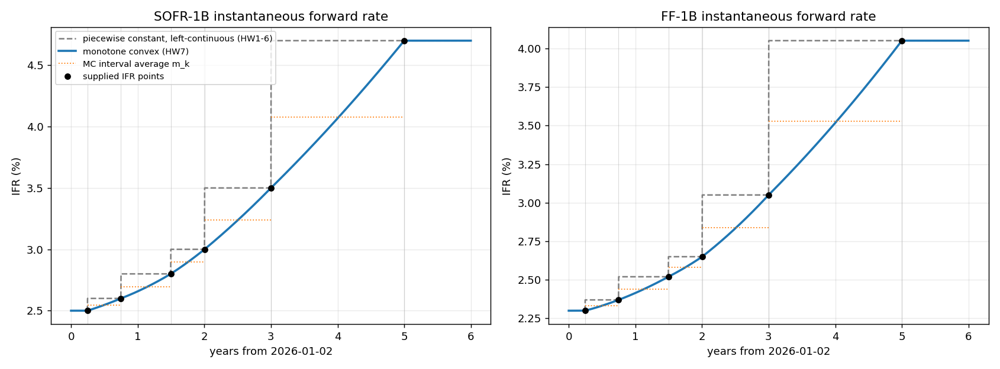

# HW7 — a monotone convex IFR interpolator: implementation notes

This note records how `Interpolator1DMonotoneConvex` in
[`fixedincomelib/utilities/numerics.py`](../fixedincomelib/utilities/numerics.py)
was designed, why it has the properties the assignment asks for, how the code is
organised, what the notebook's numbers mean, and how everything was verified.
Related: [code-reuse.md](code-reuse.md) (what was and was not carried over) and
the theory note
[`docs/stochastic_calculus_and_yield_curve_calibration.md`](../../../docs/stochastic_calculus_and_yield_curve_calibration.md)
§7 at the top level of the course folder.

Contents

1. [Reading the task](#1-reading-the-task)
2. [One set of numbers, two curves](#2-one-set-of-numbers-two-curves)
3. [The method](#3-the-method)
4. [Data that cannot satisfy every condition](#4-data-that-cannot-satisfy-every-condition)
5. [What comes from Hagan–West and what does not](#5-what-comes-from-haganwest-and-what-does-not)
6. [Implementation](#6-implementation)
7. [Results on the notebook inputs](#7-results-on-the-notebook-inputs)
8. [Verification](#8-verification)
9. [Scope, limitations and flagged points](#9-scope-limitations-and-flagged-points)
10. [Alternatives considered](#10-alternatives-considered)

---

## 1. Reading the task

The notebook asks for an interpolator that, *for compatible data*, is

- **continuous**,
- **passes through the supplied IFR points**, and
- is **monotone and convex within each node interval**,

with FLAT extrapolation, a constant curve for the one-node funding spread, and an
explanation of what happens to data that cannot satisfy all three. Hagan and
West's monotone convex method is offered "for inspiration", and both of their
papers are in the repository (`HaganWest.pdf`, the Wilmott survey, and
`Hagan_West_curves_AMF.pdf`, *Interpolation Methods for Curve Construction*,
AMF 2006).

Three decisions follow from the wording.

**The inputs are point values.** The notebook labels its data "supplied IFR
point values" and requires the curve to "pass through" them, so `values[j]` is
$f(t_j)$, the instantaneous forward rate *at* node time $t_j$. This differs from
the piecewise-constant interpolator used in HW1–HW6, which treats `values[j]` as
the constant rate *on* the interval $(t_{j-1}, t_j]$ (left-continuous). The same
six numbers therefore describe two different curves, and the PV differences in
the notebook are mostly a consequence of that (§7). It also differs from
Hagan–West's own inputs, which are *discrete forwards belonging to intervals*;
§5 and §10 return to this.

**"Compatible data" means monotone and convex data.** Both supplied curves are
increasing with increasing secant slopes (SOFR: 0.20, 0.27, 0.39, 0.50, 0.60 %/yr
per interval; FF: 0.14, 0.20, 0.26, 0.40, 0.50 %/yr). For such data every piece
must be monotone *and* convex. For other data the method must still be
well-defined and should preserve whatever shape the data does have: a decreasing
stretch should stay decreasing, a concave stretch concave, and the curve must not
invent extrema or inflections the data does not show.

**Node times come from the library.** `YieldCurveBuilder` converts node dates to
year fractions with `accrued(value_date, date)` (ACT/ACT ISDA), checks they are
finite, non-negative and strictly increasing, and passes `(times, values)` to
`InterpolatorFactory`. The factory branch for `MONOTONE_CONVEX` and the enum
entry were supplied; only the class body was a TODO. `YieldCurveModelComponent`
computes $D(T) = \exp(-\int_0^T f)$ through `integrate(0, T)`, so `integrate`
is the method that prices; `interpolate` feeds the plot and the tests.

## 2. One set of numbers, two curves

| | `PIECEWISE_CONSTANT_LEFT_CONTINUOUS` (HW1–6) | `MONOTONE_CONVEX` (HW7) |
|---|---|---|
| meaning of `values[j]` | rate on $(t_{j-1}, t_j]$ | rate at $t_j$ |
| curve between nodes | flat at the *right* node's value | quadratic through both node values |
| $\int_{t_k}^{t_{k+1}} f$ | $h_k\, f_{k+1}$ | $h_k\, m_k$ with $m_k < \tfrac12(f_k+f_{k+1}) < f_{k+1}$ for increasing convex data |
| before the first node | $f_0$ | $f_0$ (same) |
| after the last node | $f_{n-1}$ | $f_{n-1}$ (same) |
| continuity | jumps at nodes | continuous |
| gradients | overlap lengths (HW1) | dual rows (§6) |

The two wings coincide, so every difference between the notebook's PV pairs is
produced strictly inside the node intervals.

## 3. The method

Notation: nodes $t_0 < \dots < t_{n-1}$, values $f_k$, interval
$I_k = [t_k, t_{k+1}]$ of length $h_k$, local coordinate $u = (t-t_k)/h_k$,
secant slope $\delta_k = (f_{k+1}-f_k)/h_k$.

### 3.1 The quadratic piece (Hagan–West eq. 34/47)

On $I_k$ the curve is

$$
f(t) = m_k + g^0_k\,(1-4u+3u^2) + g^1_k\,(-2u+3u^2),
\qquad g^0_k = f_k - m_k,\quad g^1_k = f_{k+1} - m_k .
$$

Both basis polynomials integrate to zero over $[0,1]$, so this is the unique
quadratic with $f(t_k)=f_k$, $f(t_{k+1})=f_{k+1}$ and **interval average**
$\frac1{h_k}\int_{I_k} f = m_k$. Hagan and West derive it from exactly these
three conditions (their eq. 33), with $m_k$ equal to a market discrete forward
$f^d_k$. Here the node values are the data, so $m_k$ is the one free parameter
per interval, and choosing it is the whole design.

Useful consequences of the form, used below:

- $f'' \equiv 6\,(g^0_k + g^1_k)/h_k^2 = 6\,(f_k + f_{k+1} - 2m_k)/h_k^2$ — a
  constant on the piece, so a piece has a **single curvature sign** and cannot
  inflect;
- end slopes $f'(t_k^+) = (\delta_k - 6e_k/h_k)$ and
  $f'(t_{k+1}^-) = (\delta_k + 6e_k/h_k)$ with $e_k := \tfrac12(f_k+f_{k+1}) - m_k$
  (the gap between the chord midpoint and the average).

### 3.2 Choosing the interval average from a curvature estimate

If $f$ were a quadratic with second derivative $c$ through the two endpoint
values, its average over $I_k$ would be

$$
m_k = \tfrac12\,(f_k + f_{k+1}) - \frac{h_k^2}{12}\, c .
$$

(Write $f = \text{chord} + \tfrac{c}{2}(t-t_k)(t-t_{k+1})$ and use
$\frac1{h}\int_{I_k}(t-t_k)(t-t_{k+1})\,dt = -h^2/6$.) This is the
Hermite–Hadamard inequality made exact: a convex function's average lies below
its chord midpoint, by an amount set by its curvature. So I set $m_k$ by this
formula with a **local curvature estimate** $c_k$, and then $f'' \equiv c_k$ on
the piece — the estimate *is* the curvature of the piece.

$c_k$ is built from the two parabolas that pass through the interval's
endpoints and one further node:

- $c_L$ = second derivative of the parabola through $t_{k-1}, t_k, t_{k+1}$
  $= 2\,(\delta_k - \delta_{k-1})/(t_{k+1}-t_{k-1})$ (twice the second divided
  difference);
- $c_R$ = the same through $t_k, t_{k+1}, t_{k+2}$.

Combination rule:

| situation | $c_k$ | reason |
|---|---|---|
| both exist, same sign (or one is zero) | $\tfrac12(c_L + c_R)$ | both local models agree on the curvature sign |
| both exist, opposite signs | $0$ | the data inflects at this interval: no curvature is justified, the piece is straight |
| only one exists (first / last interval) | that one | the only local information available |
| two nodes in total | $0$ | a straight line |
| one node | — | the constant $f_0$ |

### 3.3 The monotonicity cap

From the end-slope formulas, with $e_k = h_k^2 c_k/12$, the quadratic is monotone
on $I_k$ if and only if $f'(t_k^+)$ and $f'(t_{k+1}^-)$ do not have opposite
signs, i.e.

$$
|e_k| \le \frac{|\delta_k|}{6}
\quad\Longleftrightarrow\quad
|c_k| \le \frac{2\,|\delta_k|}{h_k}.
$$

This is Hagan–West's sector (i): $g'(0)$ and $g'(1)$ share a sign. I therefore
**cap** $|c_k|$ at $2|\delta_k|/h_k$ (rescaling, which keeps its sign). Two
things are worth noticing:

- the bound is *exactly* the condition under which a quadratic through the two
  endpoints is monotone on the interval, so the method reproduces **every**
  quadratic that is monotone on each interval (§3.5);
- when the cap binds, one end slope is exactly zero: the piece starts or ends
  flat and then bends, instead of overshooting. With $\delta_k = 0$ (equal
  neighbours) the cap is zero and the piece is flat.

For the notebook's data the cap is slack by a factor between 4.6 and 9.7
(SOFR: $c_k$ = 0.109, 0.156, 0.172, 0.104, 0.066 %/yr² against caps of 0.80,
0.72, 1.56, 1.01, 0.60 %/yr²), so the pieces are the untouched averages of the
local parabolas.

### 3.4 Extrapolation and degenerate cases

- $t < t_0$: $f = f_0$; $t > t_{n-1}$: $f = f_{n-1}$ (FLAT; the constructor
  rejects any other `ExtrapMethod`, as the PCP class does).
- One node: the constant $f_0$ everywhere, so the funding-spread curve is
  constant as required.
- `integrate(a, b)` with $a > b$ returns $-\,$`integrate(b, a)`, and with $a=b$
  returns 0.

### 3.5 Properties, with the one-line proofs

| property | why it holds |
|---|---|
| passes through every node | $f(t_k) = m_k + g^0_k = f_k$ and $f(t_{k+1}) = m_k + g^1_k = f_{k+1}$ |
| continuous | the pieces meeting at $t_k$ both equal $f_k$ there; the wings equal $f_0$, $f_{n-1}$ |
| monotone on every piece | the cap (§3.3) |
| no overshoot; positive data ⇒ positive curve | a monotone piece lies between its endpoint values; the wings are node values |
| single curvature sign per piece | $f''$ is constant on a quadratic |
| convex pieces for convex data | all second divided differences $\ge 0$ ⇒ $c_L, c_R \ge 0$ ⇒ $c_k \ge 0$ (the cap preserves sign) ⇒ $f'' \ge 0$; likewise concave for concave data |
| monotone & convex for the notebook's data | both conditions above hold for SOFR and FF; §7 tabulates $c_k > 0$ and the grid checks |
| exact for constants, lines and per-interval-monotone quadratics | then $c_L = c_R = f''$ exactly, the cap is slack, and the quadratic with the right endpoints and average is unique |
| local | $f$ on $I_k$ depends on $f_{k-1}, \dots, f_{k+2}$ only |
| interval average is $m_k$ | $\int_{I_k} f = h_k m_k$, so $D(t_{k+1})/D(t_k) = e^{-h_k m_k}$ — the quantity the notebook's PV differences are explained by |

On accuracy: because the node values are exact and the curvature estimate has
$O(h)$ error, the piece error for a smooth curve is $O(h^3)$ and the discount
factors inherit one more order. Hagan–West quote $O(h^2)$ for their basic
interpolator; the difference is that their node values are themselves
$O(h^2)$ estimates from interval averages. This is a remark, not a tested claim.

## 4. Data that cannot satisfy every condition

"Monotone and convex" cannot hold for data that is not itself monotone and
convex, so the method falls back to preserving the shape the data has. The
behaviour on each failure mode (all of them covered by
`test_incompatible_data_is_handled_without_overshoot`):

| data | behaviour | mechanism |
|---|---|---|
| local maximum at a node (hump) | concave pieces on both sides, zero slope at the node, no interior extremum | $c_L, c_R \le 0$ ⇒ concave; the cap binds exactly at the node, giving a zero end slope |
| equal neighbouring values (plateau) | flat piece | $\delta_k = 0$ ⇒ cap $=0$ ⇒ $c_k = 0$, $m_k$ = the common value |
| curvature changes sign (inflection) | straight piece between the two parabolas | opposite-sign rule ⇒ $c_k = 0$ |
| decreasing data | decreasing curve | the same analysis with $\delta_k < 0$ |
| a step too steep for a monotone parabola | the piece starts or ends flat and bends; stays within the data range | the cap |
| mixed curve (increasing then decreasing) | each piece follows its own local shape; the curve is bounded by the node values everywhere | all of the above are per-interval |

What the method does **not** do, by choice:

- it never adds an extremum inside an interval (Hagan–West's sector (iv) does,
  when the data forces one between two interval averages; with point data there
  is never a reason to);
- it never oscillates: being bounded by adjacent node values is a stronger
  guarantee than Hagan–West's positivity collar (eq. 58–62), which is not needed
  here because the node values are data, not derived quantities.

## 5. What comes from Hagan–West and what does not

| element | Hagan–West | here |
|---|---|---|
| inputs | discrete forwards $f^d_i$ on intervals; node values $f_i$ derived by eq. 30–32 | node values are the inputs; the interval average is derived |
| piece | the quadratic of eq. 34/47 with prescribed average | the same quadratic, with prescribed average |
| what fixes the average | the market discrete forward | a local curvature estimate from the two adjacent parabolas, capped |
| monotonicity | sector analysis of $g'(0), g'(1)$; sectors (ii)–(iv) insert flat segments or two quadratics | the sector-(i) condition is enforced directly by the cap, so sectors (ii)–(iv) never occur |
| convexity | "locally convex if the inputs show the analogous discrete property" | a convex piece whenever both adjacent second divided differences are $\ge 0$ |
| positivity | collar on the derived $f_i$ (eq. 58–62) | automatic: the curve is bounded by the node values |
| smoothness | $C^0$ at nodes; "amelioration" trades locality for smoothness | $C^0$ at nodes; no amelioration |
| extrapolation | flat beyond $t_n$ | flat on both wings |
| locality | $f$ on $I_i$ depends on $f^d_{i-1}, f^d_i, f^d_{i+1}$ | $f$ on $I_k$ depends on $f_{k-1}, \dots, f_{k+2}$ |

The honest summary: the *piece* and the *monotonicity analysis* are Hagan–West's;
the *choice of the free parameter* and the *cap in place of the flat-segment
sectors* are mine, forced by the change of inputs from interval averages to point
values.

## 6. Implementation

### 6.1 Layout

```
Interpolator1DMonotoneConvex(Interpolator1D)
├─ __init__                 validate; build dual node rows F; M, c = _interval_averages(F, x, h);
│                           G0 = F[:-1] - M; G1 = F[1:] - M
├─ _interval_averages       §3.2–3.3 on dual rows  -> (M, c)
├─ _piece(x)                searchsorted(side='right') - 1, clipped
├─ _value_dual(x)           wings or the quadratic piece          -> row [value, grad...]
├─ _piece_antiderivative    (1/h_k) ∫_{t_k}^{t_k+u h_k} f  in u-units
├─ _integral_dual(a, b)     left wing + overlapping pieces + right wing; antisymmetric
├─ interpolate / integrate                      column 0 of the dual row
├─ gradient_wrt_ordinate / gradient_of_integrated_value_wrt_ordinate   columns 1..n
└─ interval_averages / interval_curvatures      diagnostics for the plot and tests
```

### 6.2 Dual rows: one code path for value and gradient

Once the two data-dependent decisions are made (the sign test in §3.2 and the cap
in §3.3), every quantity — $\delta_k$, $c_k$, $m_k$, $g^0_k$, $g^1_k$, the value
of a piece, the integral over a window — is **linear in the node vector**.
The class therefore represents each scalar as a row
`[value, ∂/∂f_0, …, ∂/∂f_{n-1}]`; the node values start as `F = [f | I]`, and
ordinary numpy arithmetic propagates both columns through the same formulas.
The regime decisions read the value column and are then applied as constant
multipliers (the cap rescales a row; the inflection rule zeroes it), so the
gradient columns are exact within the regime.

This is the same idea as the HW1 interpolator's weight vectors, pushed one step
further: `interpolate` and `gradient_wrt_ordinate` are two columns of one
computation and cannot disagree, and the optional risk interface costs nothing
extra. Two consequences:

- `gradient_of_integrated_value_wrt_ordinate(0, T)` plugs straight into the
  HW5 chain `YieldCurveModelComponent.discount_factor_gradient_wrt_state` →
  `YieldCurve.discount_factor_gradient_wrt_state`, which the tests verify by
  bump-and-reval through the SOFR → SOFR-FLAT reference chain;
- exactly at a regime boundary (a node value that makes $c_L c_R = 0$, or puts
  $c_k$ on the cap) the gradient is one-sided, like the PCP class's
  `searchsorted` tie-break. Away from boundaries it is the true derivative.

### 6.3 Walkthrough of the numerics

`_interval_averages` computes `delta` (n−1 rows), `mid` (chord midpoints),
`c_node` (the parabola curvatures attached to interior nodes), then loops over
intervals applying the combination rule and the cap, and returns
`mid − (h²/12) c` together with the value column of `c`.

`_value_dual` returns the wing rows for $x \le t_0$ or $x \ge t_{n-1}$, else
evaluates the piece. `_piece` uses `searchsorted(side='right') − 1` so that a
point exactly on a node is assigned to the piece on its right; because the curve
is continuous either choice gives the same value.

`_piece_antiderivative(k, u)` integrates the three basis terms:
$\int_0^u (1-4s+3s^2)\,ds = u(1-u)^2$ and $\int_0^u (-2s+3s^2)\,ds = u^2(u-1)$,
both zero at $u=1$ so a full piece integrates to $h_k m_k$. `_integral_dual`
adds the left wing, the pieces that overlap $[a, b]$ (full or partial, via the
antiderivative at the two local coordinates) and the right wing.

Costs: $O(n)$ to build, $O(1)$ per `interpolate`, $O(\text{pieces overlapped})$
per `integrate`, each row carrying $n+1$ floats. For curve sizes in this course
(six nodes) this is negligible; for thousands of nodes one would keep the dual
rows sparse.

### 6.4 How the library reaches it

`qfCreateBuildMethod(..., {"INTERPOLATION METHOD": "MONOTONE_CONVEX"})` →
`InterpMethod.from_string` → `YieldCurveModelComponent.__init__` →
`InterpolatorFactory.create_1d_interpolator` → this class. Rebuilding the model
with the other string selects the PCP class; nothing else in the notebook
changes, which is the point of the factory. `perturb_model_parameter` rebuilds
the interpolator after each bump, which is what makes the bump-and-reval test
meaningful.

### 6.5 Validation

The constructor raises `ValueError` for a non-FLAT extrapolation method, an empty
axis, non-finite inputs, or node times that are not strictly increasing
(`InterpolatorFactory` only asserts non-decreasing; a zero-length interval would
divide by zero here, and `YieldCurveBuilder` already rejects it upstream).

## 7. Results on the notebook inputs



Dashed grey: the left-continuous piecewise-constant curve; blue: the monotone
convex curve; dotted orange: its interval averages $m_k$; black: the supplied
points. Both curves share the two flat wings.

### 7.1 Interval table (SOFR-1B, value date 2026-01-02)

| interval | $h_k$ | $f_k \to f_{k+1}$ | PCP rate on the interval | chord mid | $m_k$ | $c_k$ (%/yr²) | cap (%/yr²) |
|---|---|---|---|---|---|---|---|
| 2026-04-02 → 2026-10-02 | 0.501 | 2.5 → 2.6 | 2.6 | 2.55 | 2.5477 | 0.109 | 0.80 |
| 2026-10-02 → 2027-07-02 | 0.748 | 2.6 → 2.8 | 2.8 | 2.70 | 2.6927 | 0.156 | 0.72 |
| 2027-07-02 → 2028-01-03 | 0.507 | 2.8 → 3.0 | 3.0 | 2.90 | 2.8963 | 0.172 | 1.56 |
| 2028-01-03 → 2029-01-02 | 0.997 | 3.0 → 3.5 | 3.5 | 3.25 | 3.2414 | 0.104 | 1.01 |
| 2029-01-02 → 2031-01-02 | 2.000 | 3.5 → 4.7 | 4.7 | 4.10 | 4.0781 | 0.066 | 0.60 |

FF-1B: $m_k$ = 2.3330, 2.4406, 2.5820, 2.8393, 3.5280 % against chord midpoints
2.335, 2.445, 2.585, 2.85, 3.55 % and $c_k$ = 0.098, 0.093, 0.141, 0.129, 0.066
%/yr². Every $c_k$ is positive and every $m_k$ sits below its chord midpoint,
which is the convexity statement in numbers; the notebook's grid check reports
monotone and convex on every interval for both curves.

### 7.2 PVs and why they differ

| product | PCP | monotone convex | difference |
|---|---|---|---|
| FRA, receive 3.2%, 2026-05-05 → 2026-11-05 | 2,908.2866 | 3,262.3771 | +354.0904 |
| RFR swap, receive 3.4%, 3Y from 2026-04-02 | 6,222.5175 | 12,860.3995 | +6,637.8820 |
| basis swap, receive SOFR + 10 bp vs FF, 2Y from 2026-07-02 | 8,351.3489 | 7,624.0991 | −727.2498 |

The driver is the same in all three: for increasing data the PCP curve assigns
each interval the value at its right end, while the monotone convex curve's
interval average is below the chord midpoint, so **every projected forward rate
is lower** and every discount factor higher. The direction of the PV change then
follows from which leg the trade receives.

**FRA.** The accrual window sits inside the first node interval. PCP projects
2.6182 %; the monotone convex curve projects 2.5476 % (average 2.5477 % on
Apr → Oct, below the 2.55 % chord midpoint). A receiver of 3.2 % gains
$N\alpha\,\Delta F\,D \approx 10^6 \times 0.5111 \times 0.000706 \times 0.978 = 353$,
and a few dollars more from the higher funding discount factor
(0.97801647 → 0.97844604). The cash-flow check
$N\alpha(K-F)D$ reproduces both PVs to the cent.

**RFR swap.** A compounded SOFR coupon equals $D(T_s)/D(T_e) - 1$, i.e. the
average IFR over the coupon under either curve. PCP's averages on the five
intervals are 2.6, 2.8, 3.0, 3.5, 4.7 %; the monotone convex averages are
2.548, 2.693, 2.896, 3.241, 4.078 %. The floating leg falls from 90,552.57 to
84,253.77 (−6,298.80) while the fixed leg rises from 96,775.09 to 97,114.17
(+339.09) because the funding curve (SOFR + 5 bp) discounts less. Net
+6,637.88 — the PCP reading overstated the three-year forwards by roughly
20 bp on average.

**Basis swap.** Both projected legs fall: the SOFR leg (without spread)
57,542.73 → 54,478.37 (−3,064.37) and the FF leg 51,134.04 → 48,799.89
(−2,334.16). The received SOFR leg falls by more because the SOFR curve is
steeper (2.5 → 4.7 % against 2.3 → 4.05 %), so its averages sit further below
the right-node rates. The spread stream only feels discounting
(1,942.66 → 1,945.62). Net −3,064.37 + 2.96 + 2,334.16 = −727.25.

**Which is "right"?** Neither — they answer different questions. If the quoted
numbers are the rates expected to prevail *on* each interval, PCP is the faithful
reading; if they are the forward rates *at* the node dates (as the notebook
says), the monotone convex curve is. The test suite checks that the two agree
exactly when the data is flat, which is the only case where the two readings
coincide.

## 8. Verification

There is no reference output for the monotone convex PVs, so the checks are
identities and properties that any correct implementation must satisfy, plus a
mutation test to confirm the suite can tell a wrong implementation from a right
one. All of it is in
[`tests/test_monotone_convex_interpolator.py`](../tests/test_monotone_convex_interpolator.py)
(12 tests, all passing):

| test | what it establishes |
|---|---|
| nodes and continuity | $f(t_j) = f_j$ to 1e−15; left and right limits agree at every node |
| extrapolation, one node | flat wings; the one-node curve is constant, its integral is length × value, its gradient is the length |
| two nodes | the straight line |
| exactness | constants, lines and a monotone quadratic reproduced to 1e−14 in value and integral; $c_k$ = the true $f''$ |
| monotone & convex (SOFR, FF) | $c_k > 0$; $m_k$ below chord midpoints; first and second differences $\ge 0$ on a 4001-point grid per interval; bounded by node values; positive |
| integral identities | piece integral = $h_k m_k$; additivity; antisymmetry; agreement with 200,001-point trapezoid quadrature to 1e−9 on node-aligned *and* mid-piece windows |
| incompatible data | hump, plateau, inflection, decreasing and over-steep data behave as in §4 |
| gradients (interpolator) | both gradients match central differences (step 1e−7) to 1e−8; the integral's weights sum to the window length |
| gradients (model) | `discount_factor_gradient_wrt_state` for SOFR-1B-FLAT matches bump-and-reval through the reference chain to 1e−7, with the model restored afterwards |
| class selection | the build-method string selects the class for all three components; the funding curve is $e^{-0.0005\,t}$ |
| notebook PVs | the three PCP values from the supplied notebook and the three monotone convex values, to 1e−6; the monotone convex FRA forward is below the PCP forward; the signs of all three differences |
| flat data | PCP and monotone convex PVs coincide for flat curves |

**Mutation testing.** Seven plausible bugs were planted one at a time, the suite
run, and the file restored byte-for-byte (checked with `cmp`):

| planted bug | tests failing |
|---|---|
| cap removed | 1 (over-steep data overshoots) |
| curvature ignored (linear pieces) | 3 |
| curvature sign flipped (averages above the chord) | 3 |
| antiderivative term sign | 3 — including the mid-piece quadrature check, added after the first run showed the node-aligned windows could not see this bug |
| value gradient zeroed | 1 |
| right wing returns the first node | 7 |
| inflection rule dropped | 1 |

The notebook was executed from a fresh kernel (`nbconvert --execute`) with zero
errors; cells 1–6 reproduce the supplied PCP outputs exactly and print the
monotone convex values above.

## 9. Scope, limitations and flagged points

- **$C^0$, not $C^1$, at the nodes.** Adjacent pieces generally meet with
  different slopes (visible as mild kinks in the plot). Hagan–West's method has
  the same property and they argue locality is worth more for a forward curve;
  a $C^1$ piecewise quadratic needs either a global tridiagonal solve or knot
  insertion (Schumaker), both of which give up the four-node locality.
- **The cap limits curvature.** A piece can carry at most $2|\delta_k|/h_k$ of
  curvature. Hagan–West's flat-segment sectors would allow more while staying
  monotone; for IFR data the cap is far from binding (§3.3) and the simpler
  single-quadratic piece was preferred.
- **End intervals use one-sided curvature.** The first and last pieces take the
  only parabola available. Hagan–West instead impose $f'(0) = 0 = f'(t_n)$ on
  their derived end values; with given end values there is nothing to impose.
- **The curvature mean is unweighted.** With very uneven spacing a
  distance-weighted mean of $c_L$ and $c_R$ would be a defensible alternative;
  it changes nothing in the guarantees.
- **Gradients at regime boundaries are one-sided** (§6.2).
- **Risk through the engines is still HW6 scope.** `FirstOrderRisk` on a
  stream, FRA or swap raises `NotImplementedError` in the shipped engines; only
  `ValuationEngineProductFixedAccrued` implements it. The interpolator and the
  model-level discount-factor gradient are complete and tested, so extending the
  engines is a matter of the HW5 chain rule, not of this class.
- Node times are ACT/ACT ISDA year fractions while coupons accrue ACT/360;
  this is the library's convention from HW4 and is unchanged.

## 10. Alternatives considered

| alternative | why not |
|---|---|
| Hagan–West verbatim, treating `values[j]` as the discrete forward on $(t_{j-1}, t_j]$ | contradicts "pass through the supplied IFR points"; it would reproduce PCP's discount factors at every node exactly and only redistribute rates inside intervals |
| linear interpolation | trivially monotone and convex per piece, but carries no curvature: the convexity the data shows is lost, and the interval average is the chord midpoint, which overstates the average of a convex curve |
| monotone cubic Hermite (Fritsch–Carlson / Hyman) | $C^1$, but a cubic can inflect inside an interval; convexity needs extra slope constraints that are harder to prove than the one-scalar-per-interval analysis here |
| $C^1$ quadratic spline through the points | smooth but global (tridiagonal system) and known to oscillate; loses locality |
| Schumaker's shape-preserving quadratic spline | $C^1$, monotone and convex, but needs an extra knot per interval and prescribed slopes; more machinery for a smoothness the assignment does not ask for |
| harmonic instead of arithmetic mean of $c_L, c_R$ | the classic shape-preserving limiter, but non-linear in the data, which would break the exact dual-row gradients; the arithmetic mean gives the same guarantees |
